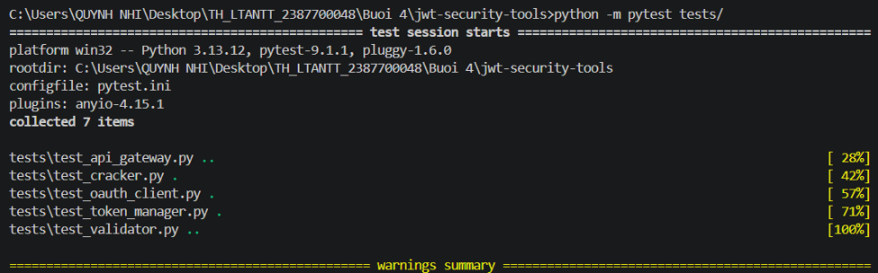
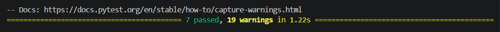
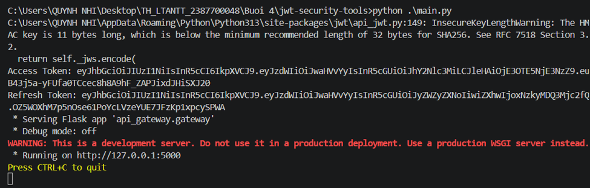
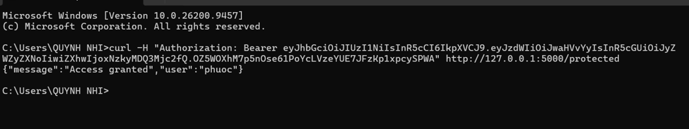

# Báo cáo Thực hành: JWT và bảo mật OAUTH 

## 1. Giới thiệu
Dự án này xây dựng một hệ thống công cụ bảo mật và quản lý JSON Web Token (jwt-security-tools) trên nền tảng Python. Hệ thống tích hợp các cơ chế bảo mật và xác thực hiện đại, bao gồm:
- Quản lý và Cấp phát Token (Token Manager): Tự động sinh cặp Access Token (ngắn hạn) và Refresh Token (dài hạn) sử dụng thuật toán ký số HS256.
- Xác thực API Gateway: Triển khai API Gateway bằng Flask với endpoint được bảo vệ (/protected), yêu cầu kiểm tra và giải mã JWT từ tiêu đề Authorization: Bearer <token>.
- Kiểm tra và Xác thực Token (JWT Validator): Cung cấp mô-đun kiểm tra tính hợp lệ của token, xử lý các ngoại lệ như chữ ký không hợp lệ (InvalidSignatureError) hoặc token hết hạn (ExpiredSignatureError).
- Mô-đun Tấn công/Kiểm thử Khóa (JWT Cracker): Hỗ trợ tính năng dò tìm mật khẩu bí mật (secret key) của JWT thông qua từ điển (wordlist) sử dụng đa luồng (ThreadPoolExecutor).
- Tích hợp OAuth Client: Mô-đun tương thích chuẩn OAuth2 phục vụ quy trình xác thực ủy quyền.

---

## 2. Kỹ thuật và Công nghệ sử dụng
- **Ngôn ngữ lập trình:** Python.
- **Thư viện:** 
  - PyJWT: Mã hóa, giải mã, tạo lập và xác thực chữ ký số JSON Web Token.
  - Flask: Xây dựng ứng dụng web API Gateway và xử lý định tuyến yêu cầu HTTP.
  - requests: Gửi các yêu cầu HTTP trong mô-đun OAuth Client.
  - pytest & unittest: Bộ khung kiểm thử tự động toàn diện các mô-đun bảo mật.
  - concurrent.futures: Thực thi đa luồng (ThreadPoolExecutor) để tối ưu hóa quá trình dò mật khẩu token.

---

## 3. Các Test Case và Kết quả Thực hiện

Hệ thống đã được cấu hình, chạy unit tests tự động, khởi chạy dịch vụ API Gateway và kiểm thử thành công qua dòng lệnh bằng công cụ curl. Dưới đây là các test case chi tiết:

### Test Case 1: Chạy Kiểm thử Tự động (Pytest)

- **Mô tả:** Thực thi bộ kiểm thử tự động với lệnh pytest tests/ để xác minh toàn bộ các mô-đun (API Gateway, Cracker, OAuth Client, Token Manager, Validator).
- **Kỹ thuật áp dụng:** Sử dụng file cấu hình pytest.ini với pythonpath = . để giải quyết vấn đề import module, kết hợp các fixture kiểm thử.

- **Kết quả thực hiện:**
  * Collected 7 items, toàn bộ 7 test case đã vượt qua thành công (7 passed) trong thời gian 1.22 giây.

### Test Case 2: Khởi động API Gateway và Cấp phát Token

- **Mô tả:** Chạy chương trình chính main.py để khởi tạo TokenManager, sinh chuỗi Access Token và Refresh Token cho định danh người dùng, đồng thời khởi chạy dịch vụ Flask API Gateway tại cổng 5000.
- **Kỹ thuật áp dụng:** Ký số HMAC-SHA256 (HS256) kết hợp thời gian sống (exp) cho token.
- **Kết quả thực hiện:**
  * Chương trình sinh thành công Access Token và Refresh Token, đồng thời khởi động Flask app: Running on (http://127.0.0.1:5000).

### Test Case 3: Kiểm thử Truy cập API Bảo vệ với Token Hợp lệ (cURL)

- **Mô tả:** Sử dụng công cụ dòng lệnh curl để gửi yêu cầu HTTP GET kèm theo tiêu đề Authorization: Bearer <access_token> đến endpoint /protected.
- **Kỹ thuật áp dụng:** API Gateway giải mã token bằng khóa bí mật (secret), trích xuất thông tin định danh sub từ payload.
- **Kết quả thực hiện:** 
  * Máy chủ phản hồi mã trạng thái thành công kèm theo nội dung JSON: {"message":"Access granted","user":"phuoc"}.

### Test Case 4: Kiểm thử Xử lý Token Không hợp lệ / Sai chữ ký
- **Mô tả:** Kiểm tra cơ chế bảo mật của API Gateway khi client gửi lên một token không hợp lệ hoặc sai định dạng/chữ ký.
- **Kỹ thuật áp dụng:** Bắt ngoại lệ InvalidTokenError và trả về mã lỗi HTTP 401 Unauthorized kèm thông báo từ chối truy cập.
- **Kết quả thực hiện:** 
  * Hệ thống ngăn chặn truy cập trái phép thành công và trả về mã lỗi 401 đúng theo thiết kế bảo mật.

---

## 4. Cấu trúc Thư mục
Sau khi hoàn tất quá trình thiết lập và triển khai, cấu trúc thư mục dự án gồm các thành phần:
- api_gateway/: Chứa gateway.py cấu hình ứng dụng Flask bảo vệ route /protected.
- jwt_cracker/: Chứa cracker.py thực hiện dò tìm khóa bí mật JWT bằng đa luồng.
- jwt_validator/: Chứa validator.py xử lý kiểm tra ngoại lệ chữ ký và thời hạn token.
- oauth_client/: Chứa client.py hỗ trợ tích hợp luồng xác thực OAuth2.
- token_manager/: Chứa manager.py quản lý sinh và làm mới access/refresh token.
- tests/: Chứa các kịch bản kiểm thử (test_api_gateway.py, test_cracker.py, test_oauth_client.py, test_token_manager.py, test_validator.py).
- main.py: Tệp chạy chương trình chính khởi tạo token và dịch vụ API Gateway.
- requirements.txt: Danh sách các thư viện phụ thuộc (PyJWT, requests, flask, pytest).
- pytest.ini: Cấu hình môi trường cho công cụ pytest.