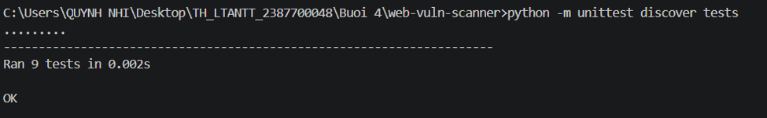
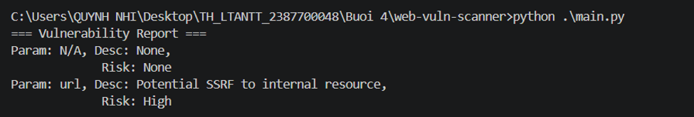
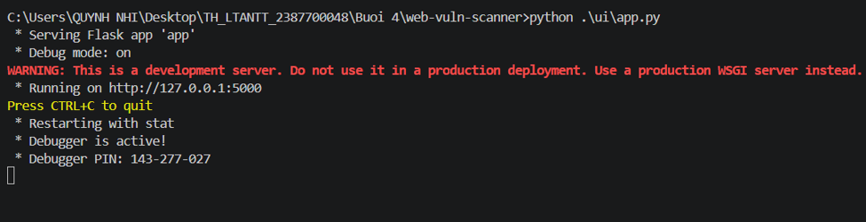
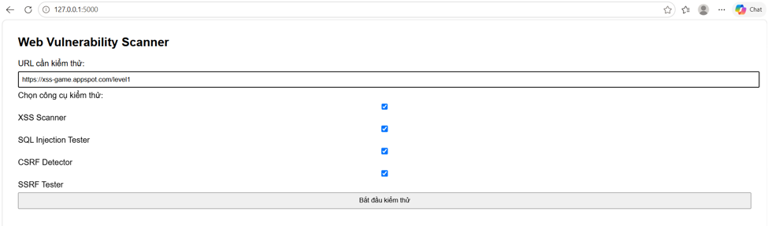
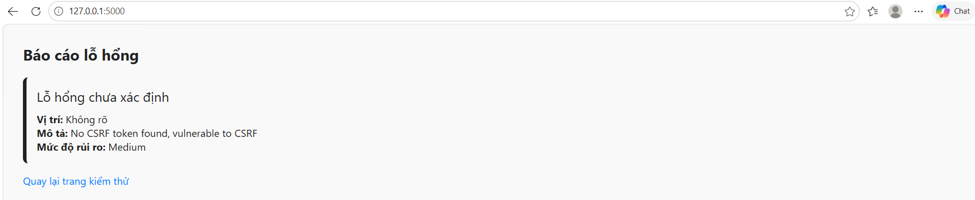

# Báo cáo Thực hành: Lỗ hổng ứng dụng WEB

## 1. Giới thiệu
Dự án này xây dựng một bộ công cụ kiểm thử bảo mật ứng dụng web bằng Python (web-vuln-scanner), hỗ trợ phát hiện các lỗ hổng phổ biến bao gồm XSS (Cross-Site Scripting), SQL Injection (SQLi), CSRF (Cross-Site Request Forgery), SSRF (Server-Side Request Forgery), cùng với hệ thống quản lý/xác thực mã thông báo JWT (JSON Web Token). Hệ thống tích hợp giao diện web trực quan bằng Flask và cung cấp hệ thống báo cáo tự động giúp phân tích và hiển thị kết quả kiểm thử rủi ro rõ ràng.

---

## 2. Kỹ thuật và Công nghệ sử dụng
- **Ngôn ngữ lập trình:** Python.
- **Thư viện:** 
  - Flask: Xây dựng giao diện web UI tương tác (app.py, index.html, result.html).

  - requests: Thực thi các HTTP request kiểm thử gửi tới URL mục tiêu.

  - PyJWT: Quản lý, ký, giải mã, xác thực và kiểm thử các chính sách JWT.

  - unittest / pytest: Chạy bộ test case kiểm thử tự động toàn diện các mô-đun bảo mật.
- **Mục tiêu kiểm thử mẫu:**
  - Các trang web mô phỏng lỗ hổng (https://xss-game.appspot.com/level1, http://testphp.vulnweb.com/).

---

## 3. Các Test Case và Kết quả Thực hiện

Hệ thống đã được cấu hình, viết test case, kiểm thử tự động qua mô-đun Python UnitTest/PyTest và chạy xác thực trên giao diện Web UI cục bộ. Dưới đây là các test case chi tiết:

### Test Case 1: Chạy Bộ kiểm thử Tự động (Unit Testing)

- **Mô tả:** Sử dụng công cụ unittest để kiểm tra toàn bộ các thành phần mã nguồn bảo mật của hệ thống thông qua câu lệnh: python -m unittest discover tests.
- **Kết quả thực hiện:**
  * Chương trình thực thi thành công tổng cộng 9 bài kiểm thử độc lập.
  * Trạng thái trả về: Ran 9 tests in 0.002s - OK, xác thực toàn bộ các mô-đun quét lỗ hổng và xử lý báo cáo hoạt động chính xác.

### Test Case 2: Kiểm thử Chương trình Quét dòng lệnh (CLI Core Scanning)

- **Mô tả:** Chạy chương trình chính main.py để quét mục tiêu cấu hình sẵn và sinh báo cáo tổng hợp.
- **Kết quả thực hiện:**
  * Báo cáo lỗ hổng hiển thị trên terminal bao gồm mức độ rủi ro (Risk: High cho tham số url tiềm ẩn lỗ hổng SSRF).

### Test Case 3: Khởi chạy và Tương tác Web UI (Flask Application)

- **Mô tả:** Khởi động ứng dụng Flask UI bằng lệnh python .\ui\app.py, hệ thống chạy máy chủ phát triển tại http://127.0.0.1:5000. Người dùng truy cập trình duyệt để cấu hình URL mục tiêu và chọn các mô-đun quét (XSS Scanner, SQL Injection Tester, CSRF Detector, SSRF Tester).
- **Kết quả thực hiện:** 
  * Giao diện web hiển thị form nhập liệu trực quan, cho phép người dùng tùy chọn công cụ kiểm thử linh hoạt theo nhu cầu.

### Test Case 4: Thực thi Quét và Báo cáo Lỗ hổng qua Web UI

- **Mô tả:** Nhập các URL mẫu (ví dụ: https://xss-game.appspot.com/level1, http://testphp.vulnweb.com/artists.php?artist=1', http://testphp.vulnweb.com/showimage.php?file=1), tích chọn toàn bộ các bộ công cụ kiểm thử và nhấn Bắt đầu kiểm thử.

- **Kết quả thực hiện:** 
  * Hệ thống phân tích đối tượng và trả về trang báo cáo chi tiết (result.html) được phân loại theo mức độ rủi ro (ví dụ: phát hiện lỗi thiếu mã thông báo CSRF với mức độ rủi ro Medium).
  * Giao diện hỗ trợ liên kết nhanh quay lại trang kiểm thử (Quay lại trang kiểm thử).

---

## 4. Cấu trúc Thư mục
Cấu trúc tổ chức mã nguồn của dự án bao gồm:
- ui/app.py: Tệp ứng dụng Flask quản lý định tuyến, xử lý biểu mẫu và điều phối luồng quét web.
- ui/templates/index.html: Giao diện trang chủ cho phép nhập URL và chọn công cụ quét.
- ui/templates/result.html: Giao diện hiển thị báo cáo lỗ hổng chi tiết theo mức độ rủi ro.
- report/report_generator.py: Mô-đun tổng hợp kết quả từ các scanner thành định dạng báo cáo chuẩn.
- scanners/: Chứa các mô-đun phát hiện lỗ hổng (xss_scanner.py, sql_injection_tester.py, csrf_detector.py, ssrf_tester.py).
- tests/: Thư mục chứa các tệp kiểm thử tự động (Unit tests).