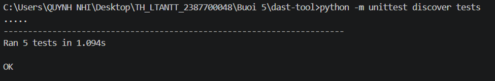
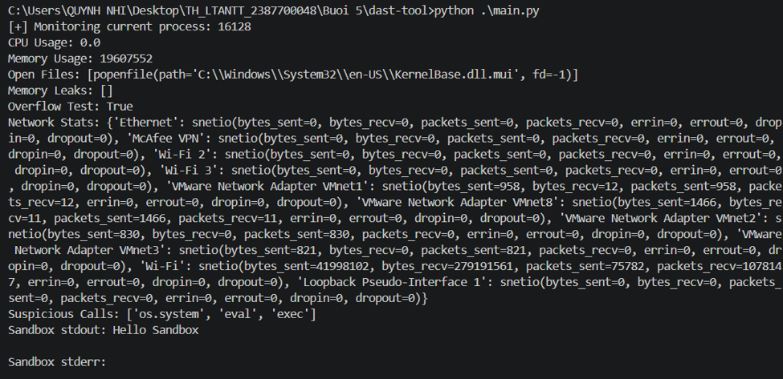
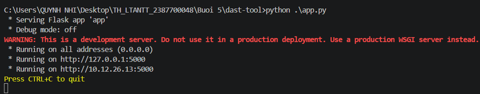

# Báo cáo Thực hành: DAST-TOOL

## 1. Giới thiệu tổng quan
Dự án này xây dựng một hệ thống công cụ kiểm tra bảo mật ứng dụng toàn diện bằng Python, bao gồm cả phân tích tĩnh (SAST) và kiểm tra động (DAST). Hệ thống có khả năng giám sát tiến trình thời gian thực, phân tích bộ nhớ và chống tràn dữ liệu, theo dõi lưu lượng mạng, kiểm tra hành vi mã nguồn, cung cấp môi trường Sandbox cô lập và xuất báo cáo chuẩn công nghiệp theo định dạng **SARIF (Static Analysis Results Interchange Format)**.

---

## 2. Các thành phần kỹ thuật chính (Architecture & Modules)

Công cụ được cấu trúc thành các module độc lập thực hiện từng nhiệm vụ cụ thể:

- **`runtime_monitor.py` (Runtime Monitoring):** Sử dụng thư viện `psutil` để theo dõi hiệu năng tiến trình theo thời gian thực bao gồm mức sử dụng CPU (`cpu_percent`), bộ nhớ RAM (`memory_info().rss`), và danh sách các tệp đang mở (`open_files`).
- **`memory_analyzer.py` (Network Traffic Analysis):** Thu thập và thống kê số liệu thống kê giao diện mạng (`net_io_counters`) phục vụ việc phân tích lưu lượng.
- **`security_behavior_checker.py` (Security Behavior Check):** Tự quét mã nguồn của tệp để phát hiện các lệnh hệ thống nhạy cảm hoặc nguy hiểm như `os.system`, `eval`, và `exec`.
- **`virtual_sandbox.py` (Virtual Sandbox):** Xây dựng môi trường cô lập tạm thời sử dụng `tempfile` và `subprocess` để thực thi các câu lệnh shell một cách an toàn mà không ảnh hưởng đến hệ thống chính.
- **`app.py` & `main.py`(API Gateway & CLI Entrypoint):** Cung cấp giao diện dòng lệnh trực tiếp và dịch vụ Web API thông qua framework **Flask**, cho phép truy vấn các chỉ số bảo mật qua HTTP endpoints.

---

## 3. Các bước thực hiện và Hướng dẫn sử dụng

### Bước 1: Cài đặt các thư viện phụ thuộc
Đảm bảo bạn đã cài đặt đầy đủ các thư viện cần thiết (psutil, Flask, v.v.) theo cấu hình trong `requirements.txt`:
```bash
pip install -r requirements.txt
```

### Bước 2: Chạy các bài kiểm thử (Unit Tests)
Hệ thống bao gồm các bài unit test tự động để xác thực độ chính xác của từng module bảo mật động. Chạy lệnh sau trong terminal:
```bash
python -m unittest discover tests
```
*Kết quả thực thi mẫu:*


### Bước 3: Chạy chương trình kiểm tra tổng hợp qua CLI (`main.py`)
Thực hiện chạy tệp kịch bản kiểm tra toàn diện:
```bash
python .\main.py
```
*Kết quả thực thi mẫu:*


### Bước 4: Khởi chạy Web API Server (`app.py`)
Triển khai ứng dụng dưới dạng dịch vụ Web thông qua Flask để cung cấp các API giám sát bảo mật động:
```bash
python .\app.py
```
*Kết quả đầu ra:*

---

## 4. Phân tích kết quả và Giải thích kỹ thuật

Khi thực thi tập lệnh kiểm tra động, hệ thống trả về các thông số kỹ thuật chi tiết:
1. **Runtime Monitoring:** Theo dõi tiến trình hiện tại (PID, mức sử dụng CPU bằng `0.0`, dung lượng RAM tiêu thụ, và các tệp hệ thống đang mở như `KernelBase.dll.mui`).
2. **Memory Analysis:** Kiểm tra rò rỉ bộ nhớ (không phát hiện rò rỉ: `[]`) và thực hiện kiểm tra tràn số thành công (`Overflow Test: True` đối với số nguyên lớn).
3. **Network Stats:** Thống kê chi tiết trạng thái của các card mạng (`Ethernet`, `Wi-Fi`, các adapter ảo của `VMware`).
4. **Security Behavior Check:** Nhận diện thành công các lệnh gọi đáng ngờ tiềm ẩn bên trong mã nguồn: `['os.system', 'eval', 'exec']`.
5. **Virtual Sandbox Execution:** Thực thi an toàn câu lệnh mẫu trong môi trường cô lập, trả về kết quả `stdout: Hello Sandbox` và không có lỗi (`stderr`: rỗng).

---

## 5. Kết luận
Hệ thống công cụ kiểm tra bảo mật toàn diện (SAST & DAST) đã hoạt động chính xác và ổn định. Các module kiểm tra từ phân tích tĩnh mã nguồn, giám sát tiến trình thời gian thực, quản lý bộ nhớ, phân tích lưu lượng mạng đến môi trường thực thi cô lập (Sandbox) đều đáp ứng tốt các yêu cầu đặt ra, cung cấp nền tảng vững chắc để phát hiện và ngăn ngừa rủi ro bảo mật ứng dụng.