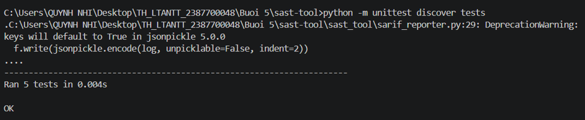
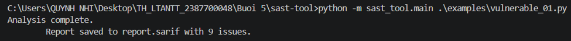
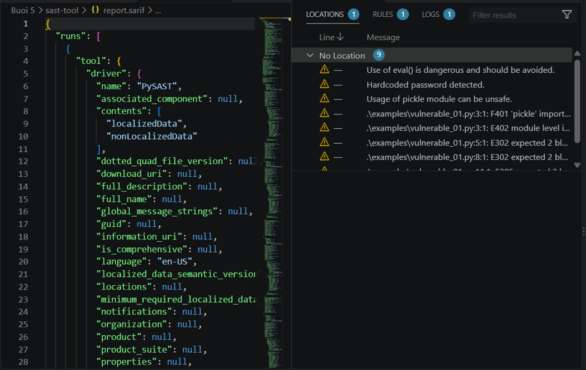

# Báo cáo Thực hành: SAST-TOOL

## 1. Giới thiệu tổng quan
Dự án này xây dựng một công cụ Phân tích Mã nguồn Tĩnh (Static Application Security Testing - SAST) bằng ngôn ngữ Python. Công cụ có khả năng quét mã nguồn ứng dụng để phát hiện các lỗ hổng bảo mật, lỗi phong cách lập trình (code quality/linting), phân loại mức độ nguy hiểm dựa trên quy tắc cấu hình tuỳ chỉnh, và xuất báo cáo chuẩn công nghiệp theo định dạng **SARIF (Static Analysis Results Interchange Format)**.

---

## 2. Các thành phần kỹ thuật chính (Architecture & Modules)

Công cụ được cấu trúc thành các module độc lập thực hiện từng nhiệm vụ cụ thể:

- **`ast_analyzer.py` (AST Analysis):** Sử dụng thư viện `ast` (Abstract Syntax Tree) tích hợp sẵn của Python để phân tích cú pháp mã nguồn dưới dạng cây cú pháp. Module này phát hiện các lệnh gọi hàm nguy hiểm như `eval()` không an toàn.
- **`vuln_pattern_matcher.py` (Pattern Matching):** Sử dụng biểu thức chính quy (`re`) để tìm kiếm các mẫu mã nguồn độc hại hoặc kém an toàn phổ biến như mật khẩu cứng (`hardcoded password`) hoặc khai báo thư viện rủi ro (`import pickle`).
- **`code_quality_checker.py` (Code Quality / Linting):** Tích hợp công cụ `flake8` thông qua `subprocess` để kiểm tra chất lượng mã nguồn, tuân thủ các chuẩn PEP 8.
- **`security_rule_engine.py` (Rule Engine):** Đọc file cấu hình quy tắc bảo mật dạng JSON (`rules/default_rules.json`) để gán mức độ nghiêm trọng (`severity`: high, medium, low) cho các lỗ hổng tìm được.
- **`sarif_reporter.py` (SARIF Reporting):** Sử dụng `sarif-om` và `jsonpickle` để tổng hợp toàn bộ kết quả phân tích thành một file báo cáo chuẩn SARIF (`report.sarif`).

---

## 3. Các bước thực hiện và Hướng dẫn sử dụng

### Bước 1: Cài đặt các thư viện phụ thuộc
Đảm bảo bạn đã cài đặt đầy đủ các thư viện cần thiết theo yêu cầu trong `requirements.txt`:
```bash
pip install -r requirements.txt
```

### Bước 2: Chạy các bài kiểm thử (Unit Tests)
Hệ thống bao gồm các bài unit test tự động dùng để xác thực từng module thành phần. Chạy lệnh sau trong terminal:
```bash
python -m unittest discover tests
```
*Kết quả thực thi mẫu:*


### Bước 3: Kiểm tra một file mã nguồn mẫu không an toàn
Thực hiện quét bảo mật trên file mã nguồn mẫu `vulnerable_01.py`:
```bash
python -m sast_tool.main .\examples\vulnerable_01.py
```
*Kết quả đầu ra:*


---

## 4. Phân tích kết quả và Giải thích kỹ thuật

Khi thực hiện quét file `vulnerable_01.py`, công cụ đã phát hiện tổng cộng **9 vấn đề bảo mật và chất lượng mã nguồn** (như hiển thị trên giao diện kết quả SARIF Viewer trong VS Code):

1. **Use of eval() detected:** Phát hiện việc sử dụng hàm `eval()` không kiểm soát đầu vào người dùng, có thể dẫn đến lỗ hổng Remote Code Execution (RCE).
2. **Hardcoded password detected:** Phát hiện mật khẩu được gán cứng trực tiếp trong mã nguồn (`password = "123456"`), vi phạm nguyên tắc bảo mật thông tin nhạy cảm.
3. **Usage of pickle module:** Phát hiện việc import module `pickle`, vốn có rủi ro thực thi mã độc khi giải tuần tự hóa dữ liệu không tin cậy.
4. **Lint Issues (PEP 8 Violations):** Các lỗi phong cách lập trình từ `flake8` như `F401` (unused import), `E402` (module level import not at top of file), và `E302` (expected 2 blank lines).

---

## 5. Kết luận
Công cụ SAST tự phát triển đã hoạt động thành công, đáp ứng tốt yêu cầu tự động hóa việc phát hiện lỗ hổng bảo mật dựa trên cả phương pháp phân tích cú pháp (AST), khớp mẫu (Regex) và kiểm tra chuẩn chất lượng mã nguồn (Linting), đồng thời chuẩn hóa định dạng xuất báo cáo theo chuẩn bảo mật quốc tế SARIF.